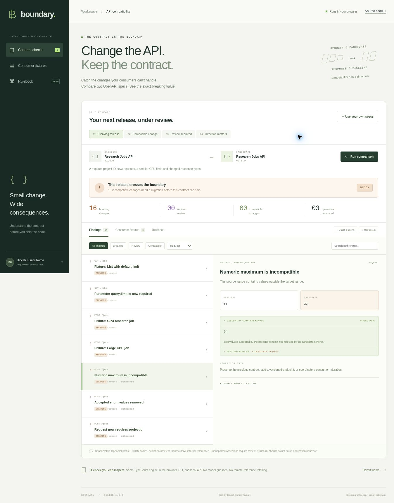

# Boundary

**Change the API. Keep the contract.**

A developer workbench and CI gate that compares two OpenAPI contracts, identifies directional incompatibilities, and constructs small **validated counterexamples**. One TypeScript engine runs in a browser worker, a command-line tool, and an isolated local HTTP API.

[Live workbench](https://dk18234.github.io/boundary-api-checker/) · [All portfolio projects](https://dk18234.github.io/webhook-recovery-lab/projects/) · [Beginner learning path](guide/LEARNING.md) · [Exact rule profile](guide/RULES.md)



## Why this exists

A harmless-looking enum edit can break deployed clients. Accepting a new **request** value expands what the server can handle; returning a new **response** value expands what an old consumer must understand. A text diff cannot express that difference.

Boundary compares those directions explicitly. A finding such as “numeric maximum is incompatible” can include the concrete value `64`, validated against both schemas: accepted by the baseline, rejected by a candidate that lowered the maximum to `32`.

This is a portfolio implementation with an intentionally bounded rule profile, not a complete OpenAPI validator or a general JSON Schema containment solver. Unsupported assertions require review rather than producing a silent pass. Application behavior still needs integration and consumer tests.

## Try it

The [public demo](https://dk18234.github.io/boundary-api-checker/) runs the **real engine locally in your browser**. It includes four editable cases, request/response filters, source pointers and line context, schema-value witnesses, consumer fixtures, and JSON/Markdown export. Custom JSON or YAML specifications are processed in a disposable worker; nothing is uploaded or automatically saved. Examples contain synthetic Research Jobs API data.

To run the full tool locally, install Node.js 22 or newer:

```bash
npm ci
npm test
node bin/boundary.mjs compare examples/v1.json examples/safe.json
```

`npm test` builds the CLI, API, browser bundle, and reproducible examples before running the tests. Generated demo files in `docs/` are checked into GitHub for Pages hosting. `build/` and `node_modules/` are excluded.

```bash
node bin/boundary.mjs compare examples/v1.json examples/breaking.json \
  --fixtures examples/fixtures.json \
  --json reports/change.json --markdown reports/change.md
```

| Exit | Meaning                                                     | CI action           |
| ---- | ----------------------------------------------------------- | ------------------- |
| 0    | PASS within the supported rule profile                      | Continue            |
| 1    | BLOCK: incompatible structural change or fixture regression | Fail                |
| 2    | REVIEW: unsupported feature or ambiguous fixture            | Fail pending review |
| 3    | Invalid input, usage, resource limit, or I/O failure        | Fail                |

## Replay actual HTTP traffic

Run the synthetic candidate service in one terminal:

```bash
DEMO_VERSION=safe node build/demo-service.js
```

In another terminal:

```bash
node bin/boundary.mjs replay examples/v1.json examples/safe.json \
  --fixtures examples/fixtures.json --base-url http://127.0.0.1:8085 \
  --json reports/replay.json
```

Restart the service with `DEMO_VERSION=breaking` and replay against `examples/breaking.json` to observe rejected requests and outputs outside the old schema. Replay performs actual bounded HTTP requests; it is available only in the local CLI. It accepts loopback HTTP destinations, rejects redirects and fixture authorization/cookie/transport headers, limits each response to 64 KiB, and times out after five seconds.

Replay reports **only the exercised fixtures**, not static compatibility of the whole contract. Run `compare` and `replay` together. Only replay fixtures against a disposable local service you intend to exercise; methods such as POST and DELETE really execute.

## Local workbench and API

```bash
export ADMIN_TOKEN="$(node -e 'console.log(require("node:crypto").randomBytes(32).toString("hex"))')"
npm start
```

Open `http://127.0.0.1:8084`. Browser comparisons remain local to the tab. The separate operator API accepts:

```bash
node -e 'const fs=require("node:fs");console.log(JSON.stringify({baseline:fs.readFileSync("examples/v1.json","utf8"),candidate:fs.readFileSync("examples/safe.json","utf8")}))' > /tmp/boundary-input.json
curl --fail http://127.0.0.1:8084/api/compare \
  -H "X-Admin-Token: $ADMIN_TOKEN" -H 'Content-Type: application/json' \
  --data-binary @/tmp/boundary-input.json
```

The token must be at least 24 characters. The API uses two admission slots and a separate worker thread for each comparison, with a 96 MiB old-generation limit and eight-second deadline. It has no HTTP replay endpoint, database, accounts, or remote reference fetching. `/health` is public. See [operations and limits](guide/OPERATIONS.md).

For Docker:

```bash
docker compose up --build
```

Compose requires the `ADMIN_TOKEN` environment variable above and exposes only `127.0.0.1:8084` on the host.

## What is implemented

- OpenAPI 3.0.x and 3.1.x JSON/YAML parsing with duplicate-key/alias rejection and bounded input.
- Direction-aware scalar types, nullability, scalar enums, numeric bounds, string/array sizes, required properties, arrays, and open/closed objects.
- Operation, scalar parameter, request-body, JSON representation, and response-status checks.
- Internal nonrecursive JSON Pointer references, physical source pointers, and line locations.
- Small counterexample search; a value is shown only after independent before/after validation proves the directional violation.
- Request fixtures and explicitly sourced candidate response fixtures. Baseline response narrowing is reported without reversing compatibility direction.
- Deterministic JSON and Markdown reports, CI exit codes, browser worker parity, and actual loopback HTTP replay.
- A shared core with a responsive, accessible browser workbench, local operator API, nonroot container, and GitHub Actions verification.

See [architecture](guide/ARCHITECTURE.md), [rule details and limitations](guide/RULES.md), [verification](guide/VERIFICATION.md), and the [learning/interview guide](guide/LEARNING.md).

## Ownership and honest presentation

Created for **Dinesh Kumar Rama**, with AI-assisted implementation. This is an independent portfolio project using synthetic contracts, not production customer work. Understand, modify, and explain the implementation before claiming independent expertise in interviews. No production impact, customer adoption, performance improvement, or commercial usage is claimed.

MIT licensed. Primary references: [OpenAPI 3.0.4](https://spec.openapis.org/oas/v3.0.4.html), [OpenAPI 3.1.1](https://spec.openapis.org/oas/v3.1.1.html), [YAML parser documentation](https://eemeli.org/yaml/).
