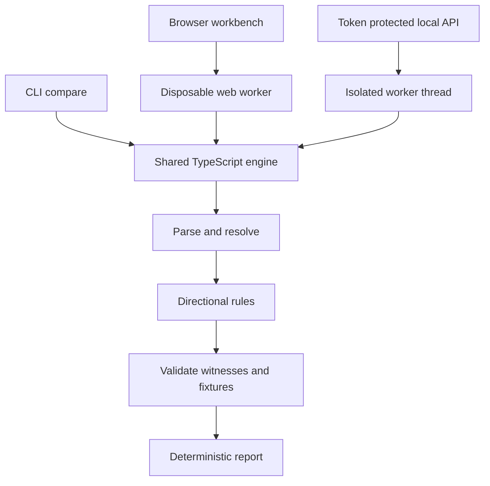

# Architecture

Boundary is a small developer tool: one comparison engine, three adapters, and a separate loopback replay adapter. There is no database because the tool does not need to retain specifications or reports.

## Data flow

1. Parse JSON or YAML using the same parser so duplicate keys, source locations, and scalar handling are consistent. Reject aliases, non-JSON data, unsafe integers, and inputs beyond the stated limits.
2. Normalize operations by method and template path. Merge path-level parameters with operation-level overrides. Resolve internal references; no HTTP requests are made to resolve references.
3. Walk every reachable contract schema for coverage. Unknown assertions emit REVIEW findings even if unchanged, because the checker cannot safely certify the whole supported contract around them. Unused components are not independently checked.
4. Compare each matched operation with a direction-aware rule set. Request source is baseline and target is candidate; response source is candidate and target is baseline.
5. Search a small set of representative values and boundary mutations. Attach a witness only if the source validator says `valid` and the target validator says `invalid`. Unknown is never enough. Witnesses describe a schema-node value, not necessarily a complete request or response.
6. Evaluate explicit consumer fixtures. Determine a stable, sorted report and an exit status. Do not include timestamps, random IDs, or credentials in report output.

## Source map

| File | Responsibility |
|---|---|
| `src/core/parse.ts` | Bounded parsing, YAML AST line mapping, internal references |
| `src/core/operations.ts` | Operation normalization and request/response fixture validation |
| `src/core/schema.ts` | Supported schema assertions, coverage, sample values, verified witness search |
| `src/core/compare.ts` | Directional contract rules and report assembly |
| `src/core/fixtures.ts` | Fixture schema, provenance, outcome policy |
| `src/core/report.ts` | Markdown, terminal summaries, exit codes |
| `src/cli.ts` | Files, arguments, reports, adapter selection |
| `src/replay.ts` | Bounded actual loopback HTTP calls |
| `src/server.ts` | Token-protected local compare API, admission, static workbench |
| `src/server-worker.ts` | Per-comparison thread boundary |
| `src/web/worker.ts` | Browser worker using the same core |
| `src/web/app.ts` | Rendering and browser interactions |
| `src/demo-service.ts` | Disposable synthetic service for actual replay |

## Deliberate tradeoffs

**Shared code over separate browser simulation.** Browser examples invoke the real engine, including custom specs. Tests run the generated browser worker bundle and compare its output with the Node engine.

**Conservative rules over a general solver.** The engine detects known incompatible deltas and explicitly reviews unsupported assertions. It does not solve satisfiability or arbitrary JSON Schema inclusion. Redundant or inconsistent constraints can yield conservative false positives; full semantic equivalence is not claimed.

**Worker isolation over a long-lived comparison queue.** The browser replaces its worker for each run; the API admits two comparisons and terminates workers after a deadline. There is no durable job queue or persisted state to recover.

**Fixture provenance over symmetric replay.** Old requests must still be accepted. Old output examples do not all need to remain possible. Candidate output examples must be acceptable to the old consumer. Treating those cases symmetrically would incorrectly block allowed response narrowing.

**No remote references.** External references produce REVIEW. This avoids sending private contract locations over the network and keeps the engine deterministic/offline after assets load.

## What a useful next version would add

A real full-schema validator with explicit dialect selection, stronger containment reasoning for unions/compositions, improved witness generation for nested complete payloads, wire-level serialization support, and authenticated replay designed around an explicit target allowlist. These are future work, not implemented features.
